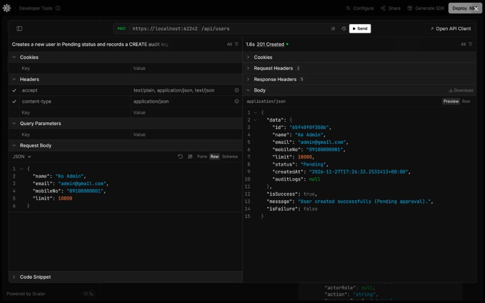
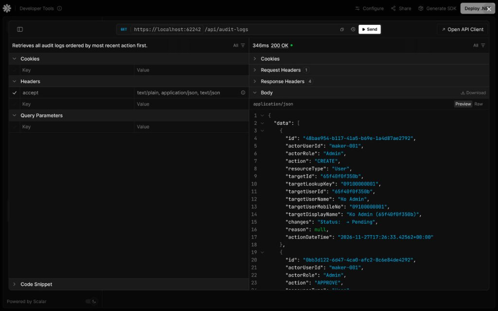

# Audit Log Sample – .NET 10 Web API

Feature-driven 4-project **ASP.NET Core Web API (.NET 10)** demonstrating:

- **CRUD + Maker/Checker Approve & Reject** → `Controller` + `IUserService` + `UserValidationPolicy` returning `Result` / `Result<T>`
- **Audit Log via MediatR** → `AuditEvent` (`INotification`) → `AuditEventHandler` → `IAuditService`
- **Atomic SQLite Persistence** → Scoped `AppDbContext` commits entity changes and `TblAuditLog` in a single transaction against `AuditLogSample.db`
- **Target Resolution** → `AuditTargetResolver` inspects EF Core `ChangeTracker` first (including newly created or deleted entities) and falls back to database lookup by ID, email, or mobile number
- **Header-Aware Actor Identity** → `CurrentUser` reads `X-User-Id` and `X-User-Role` headers (defaults to `maker-001` / `Admin`)
- **OpenAPI + Scalar UI** → Built-in `Microsoft.AspNetCore.OpenApi` + `Scalar.AspNetCore`

## Solution Structure

```text
AuditLogSample/
├── AuditLogSample.slnx
├── AuditLogSample.Api/                   # ASP.NET Core Web API, Controllers, OpenAPI/Scalar
│   ├── Controllers/Features/
│   │   ├── AuditLog/AuditLogController.cs
│   │   └── Users/UserController.cs
│   ├── CurrentUser.cs
│   ├── AuditLogSample.Api.http
│   └── Program.cs
├── AuditLogSample.Domain/                # Feature slices, services, policies, MediatR audit handler
│   ├── FeatureManager.cs                 # DI registration (builder.AddDomain())
│   └── Features/
│       ├── AuditLog/                     # AuditEvent, AuditEventHandler, AuditLogService, IAuditService, AuditTargetResolver
│       └── Users/                        # UserService (with private TrackChanges), IUserService, UserValidationPolicy, UserModels
├── AuditLogSample.Database/              # EF Core DbContext, initializer, and entity models
│   └── AppDbContextModels/
│       ├── AppDbContext.cs
│       ├── DbInitializer.cs
│       ├── TblAuditLog.cs
│       └── TblUser.cs
└── AuditLogSample.Shared/                # Shared Result / Result<T> wrapper & ICurrentUser
    ├── ICurrentUser.cs
    └── Result.cs
```

## API Endpoints

| Method | Route | Description | Audit Action |
|--------|-------|-------------|--------------|
| `GET` | `/api/users` | List all users | — |
| `GET` | `/api/users/{id}` | Get user details + target audit logs | — |
| `POST` | `/api/users` | Create user (`Status = Pending`) | `CREATE` |
| `PUT` | `/api/users/{id}` | Update user fields via `TrackChanges` | `UPDATE` |
| `DELETE` | `/api/users/{id}?reason=...` | Delete user | `DELETE` |
| `POST` | `/api/users/{id}/approve` | Approve user (`Pending → Approved`) | `APPROVE` |
| `POST` | `/api/users/{id}/reject` | Reject user (`Pending → Rejected`) | `REJECT` |
| `GET` | `/api/audit-logs` | List all audit logs | — |
| `GET` | `/api/audit-logs/target/{targetId}` | List audit logs for a user/target | — |

## Run

```bash
dotnet build AuditLogSample.slnx
dotnet run --project AuditLogSample.Api
```

- **Scalar API UI:** `http://localhost:62243/scalar/v1` (or `https://localhost:62242/scalar/v1`)
- **OpenAPI JSON:** `http://localhost:62243/openapi/v1.json`
- **HTTP Test File:** `AuditLogSample.Api/AuditLogSample.Api.http`

## Screenshots (Scalar API UI)

### Create User (`POST /api/users`)


### View Audit Logs (`GET /api/audit-logs`)

